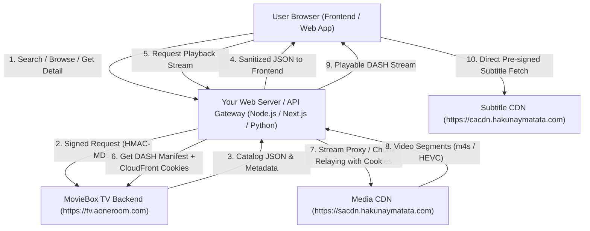

# MovieBox TV API: Web Application Architecture & Integration Guide

This document provides a comprehensive technical specification and integration blueprint for developing a streaming website using the reverse-engineered APIs from the Transsion MovieBox TV application.

---

## 1. System Architecture Overview



### Why a Backend Proxy is Required for Streaming on Web
1. **API Signing**: Requests to `https://tv.aoneroom.com` require an HMAC-MD5 signature (`x-tr-signature`) generated with a private gateway secret. Exposing the secret in browser client-side JavaScript risks blocking and abuse.
2. **CloudFront Signed Cookies & CORS**: Video streams are delivered as DASH (`.mpd`) manifests and `.m4s` fragments hosted on AWS CloudFront (`sacdn.hakunaymatata.com`). CloudFront protects these fragments with three signed cookies (`CloudFront-Policy`, `CloudFront-Signature`, `CloudFront-Key-Pair-Id`). Browsers enforce Cross-Origin Resource Sharing (CORS) and prevent client-side JavaScript from injecting cookies onto third-party CDN domains.
3. **The Solution**: Your web backend acts as a lightweight proxy/relay for the video manifest and media chunks, automatically attaching the CloudFront cookies server-side before delivering the video feed to browser players (e.g. **Shaka Player**, **Dash.js**, or **Video.js**).

---

## 2. Security & Authentication Engine

Every request to the API requires three security headers:

| Header Name | Type | Description |
| :--- | :--- | :--- |
| `x-tr-signature` | String | Gateway HMAC-MD5 digest: `{timestamp}\|2\|{base64_digest}` |
| `X-Client-Token` | String | Client integrity token: `{timestamp},{md5(reversed_timestamp)}` |
| `X-Client-Info` | JSON String | Client device & version fingerprint string |
| `User-Agent` | String | `okhttp/4.12.0` |

### 2.1. Signature Formula (`x-tr-signature`)

- **Secret Key**: `76iRl07s0xSN9jqmEWAt79EBJZulIQIsV64FZr2O` (Base64-decoded into 30 raw bytes)
- **Canonical String to Sign**:
  ```text
  {HTTP_METHOD}\n{ACCEPT}\n{CONTENT_TYPE}\n{CONTENT_LENGTH}\n{TIMESTAMP}\n{BODY_MD5}\n{CANONICAL_PATH}
  ```
- **Rules**:
  - `HTTP_METHOD`: Must be uppercase (`GET` or `POST`).
  - `ACCEPT`: `*/*`
  - `CONTENT_TYPE`: Empty for `GET`, or `application/json` for `POST`.
  - `CONTENT_LENGTH`: Empty for `GET`, or byte length for `POST`.
  - `TIMESTAMP`: Milliseconds since epoch (e.g. `1774092520123`).
  - `BODY_MD5`: MD5 hex of request body (empty for `GET`).
  - `CANONICAL_PATH`: The URI path followed by query parameters sorted alphabetically by parameter name (e.g. `/wefeed-tv-bff/search/result?keyword=Avatar&page=1&perPage=5&subjectType=0`).

### 2.2. Client Token Formula (`X-Client-Token`)

```javascript
const ts = Date.now().toString();
const reversedTs = ts.split("").reverse().join("");
const md5Hash = crypto.createHash("md5").update(reversedTs).digest("hex");
const clientToken = `${ts},${md5Hash}`;
```

### 2.3. Production Signing Implementation (Node.js / TypeScript)

```typescript
import crypto from "crypto";

const SECRET_B64 = "76iRl07s0xSN9jqmEWAt79EBJZulIQIsV64FZr2O";
const SECRET_BUFFER = Buffer.from(SECRET_B64, "base64");

export function getAuthHeaders(path: string, queryParams: Record<string, any> = {}) {
  const timestamp = Date.now();
  
  // Sort query parameters alphabetically
  const sortedKeys = Object.keys(queryParams).sort();
  const sortedQuery = sortedKeys
    .map(key => `${encodeURIComponent(key)}=${encodeURIComponent(queryParams[key])}`)
    .join("&");
    
  const canonicalPath = sortedQuery ? `${path}?${sortedQuery}` : path;
  
  // Build canonical string-to-sign
  const stringToSign = [
    "GET",
    "*/*",
    "",
    "",
    timestamp.toString(),
    "",
    canonicalPath
  ].join("\n");
  
  // Compute HMAC-MD5
  const hmac = crypto.createHmac("md5", SECRET_BUFFER);
  hmac.update(Buffer.from(stringToSign, "utf-8"));
  const signature = `${timestamp}|2|${hmac.digest("base64")}`;
  
  // Compute Client Token
  const strTs = timestamp.toString();
  const revTs = strTs.split("").reverse().join("");
  const tokenHash = crypto.createHash("md5").update(revTs).digest("hex");
  const clientToken = `${strTs},${tokenHash}`;

  const clientInfo = {
    package_name: "com.community.mbox.tv",
    version_name: "1.1.11.0915.03",
    version_code: 50040017,
    os: "android",
    os_version: "13",
    brand: "Transsion",
    model: "Infinix X6833B",
    system_language: "en",
    region: "NG",
    timezone: "Africa/Lagos",
    sp_code: "621"
  };

  return {
    "User-Agent": "okhttp/4.12.0",
    "accept": "*/*",
    "x-tr-signature": signature,
    "X-Client-Token": clientToken,
    "X-Client-Info": JSON.stringify(clientInfo),
    "X-Client-Status": "0"
  };
}
```

---

## 3. Complete Endpoints Reference

**Base API URL**: `https://tv.aoneroom.com`

### 3.1. Search API
* **Endpoint**: `GET /wefeed-tv-bff/search/result`
* **Query Parameters**:
  * `keyword` (string): Title or keywords to search.
  * `page` (int): Page number (starts at 1).
  * `perPage` (int): Items per page (default: `10` or `20`).
  * `subjectType` (int): `0` = All, `1` = Movies only, `2` = TV Series only.
* **Response Card Fields**:
  * `items[].subjectId`: Unique content ID (crucial for streaming).
  * `items[].title`: Display title.
  * `items[].releaseDate`: Format `YYYY-MM-DD`.
  * `items[].genre`: Comma-separated genres.
  * `items[].cover.url`: Poster image URL.

### 3.2. Search Suggestions (Auto-complete)
* **Endpoint**: `GET /wefeed-tv-bff/search/suggest`
* **Query Parameters**: `keyword` (string), `perPage` (int).

### 3.3. Catalog Browsing & Filter API
* **Endpoint**: `GET /wefeed-tv-bff/filter/list`
* **Query Parameters**:
  * `channelId` (int): Category channel.
  * `genre` (string): `Action`, `Comedy`, `Sci-Fi`, etc.
  * `year` (string): e.g. `2024`, `2023`, `2020s`.
  * `country` (string): e.g. `United States`, `South Korea`, `India`.
  * `sort` (string): `hot` (popular), `new` (latest release), `score` (top rated).
  * `page` (int), `perPage` (int).

### 3.4. Subject Detail API (Single Movie/Show Metadata)
* **Endpoint**: `GET /wefeed-tv-bff/subject/get`
* **Query Parameters**: `subjectId` (string).
* **Response Details**:
  * `title`: Full title.
  * `description`: Synopsis / plot summary.
  * `imdbRatingValue`: IMDb score (e.g. `7.8`).
  * `duration`: Runtime in seconds.
  * `staffList`: Array of actors, directors, writers with headshots and roles.
  * `trailer`: URL to video trailer if available.
  * `isVip`: Boolean flag.

### 3.5. TV Series Season & Episode Navigator
* **Endpoint**: `GET /wefeed-tv-bff/subject/season-info`
* **Query Parameters**: `subjectId` (string).
* **Response Details**:
  * `seasons[]`: List of available seasons.
  * `seasons[].se`: Season number (e.g. `1`, `2`).
  * `seasons[].maxEp`: Total number of episodes in this season.
  * `seasons[].resolutions[]`: Available resolutions for each episode (e.g. `720p`, `480p`, `360p`).

### 3.6. Recommended Content ("More Like This")
* **Endpoint**: `GET /wefeed-tv-bff/subject/detail-rec`
* **Query Parameters**: `subjectId` (string), `page` (int), `perPage` (int).

### 3.7. Video Streaming Play-Info API
* **Endpoint**: `GET /wefeed-tv-bff/subject/play-info/v2`
* **Query Parameters**:
  * For Movies: `subjectId={id}` (Do NOT include `se` or `ep`).
  * For Series: `subjectId={id}&se={season_num}&ep={episode_num}`.
* **Response Details**:
  * `streams[].url`: DASH MPD manifest URL (e.g. `https://sacdn.hakunaymatata.com/dash/.../index_web.mpd`).
  * `streams[].signCookie`: Full CloudFront session authentication cookies string:
    ```text
    CloudFront-Policy=ey...;CloudFront-Signature=...;CloudFront-Key-Pair-Id=KMHN1LQ1HEUPL;
    ```
  * `streams[].codecName`: Video encoding (`hevc` / H.265).
  * `streams[].resolutions`: Available stream heights (`1080`, `720`, `480`).
  * `streams[].duration`: Runtime duration in seconds.

### 3.8. Subtitles API
* **Endpoint**: `GET /wefeed-tv-bff/subject/resource`
* **Query Parameters**: `subjectId={id}&page=1&perPage=5` (for series, add `se={season}&epFrom={ep}&epTo={ep}`).
* **Response Details**:
  * `items[0].captions[]`: Array of language objects.
  * `captions[].language`: Language code (e.g. `en`, `ar`, `es`, `fr`, `hi`, `zh`, etc.).
  * `captions[].url`: Pre-signed direct download URL (includes `?Policy=...&Signature=...`).
  * *Note*: These subtitle files are standard SubRip (`.srt`) and can be downloaded directly over HTTPS without cookies.

---

## 4. Website Playback Implementation

### 4.1. Stream Relay Architecture (Node.js / Express Example)

Create an endpoint on your server `/api/stream/:subjectId/manifest.mpd` that:
1. Calls `/wefeed-tv-bff/subject/play-info/v2` to retrieve the DASH URL and CloudFront cookie.
2. Downloads the `.mpd` manifest from CloudFront using the cookie.
3. Rewrites chunk paths inside the `.mpd` to point back to your server's proxy route `/api/stream/chunk?target=...&cookie=...`.
4. Delivers the modified `.mpd` to the browser player with appropriate `Content-Type: application/dash+xml` and CORS headers.

#### Manifest & Chunk Proxy Implementation:

```typescript
import express from "express";
import fetch from "node-fetch";

const app = express();

// 1. Manifest Endpoint
app.get("/api/stream/:subjectId/manifest.mpd", async (req, res) => {
  const { subjectId } = req.params;
  const { se, ep } = req.query;
  
  // Fetch stream play-info from MovieBox backend
  const playInfo = await fetchPlayInfo(subjectId, se, ep);
  const { url: mpdUrl, signCookie } = playInfo;
  
  // Download original manifest from CloudFront with auth cookie
  const manifestRes = await fetch(mpdUrl, {
    headers: {
      "User-Agent": "okhttp/4.12.0",
      "Cookie": signCookie
    }
  });
  
  let manifestText = await manifestRes.text();
  const baseUrl = mpdUrl.substring(0, mpdUrl.lastIndexOf("/"));
  
  // Inject BaseURL so relative chunk requests route through our server proxy
  const proxyBase = `/api/stream/chunk?cookie=${encodeURIComponent(signCookie)}&base=${encodeURIComponent(baseUrl)}&segment=`;
  manifestText = manifestText.replace(/<MPD /i, `<MPD ><BaseURL>${proxyBase}</BaseURL>`);

  res.setHeader("Content-Type", "application/dash+xml");
  res.setHeader("Access-Control-Allow-Origin", "*");
  res.send(manifestText);
});

// 2. Media Chunk Relay Endpoint
app.get("/api/stream/chunk", async (req, res) => {
  const { cookie, base, segment } = req.query;
  const targetChunkUrl = `${base}/${segment}`;

  const chunkRes = await fetch(targetChunkUrl, {
    headers: {
      "User-Agent": "okhttp/4.12.0",
      "Cookie": cookie as string
    }
  });

  res.setHeader("Content-Type", chunkRes.headers.get("content-type") || "video/iso.segment");
  res.setHeader("Access-Control-Allow-Origin", "*");
  chunkRes.body.pipe(res);
});
```

---

### 4.2. Frontend Web Player (Shaka Player / Dash.js)

Using [Google Shaka Player](https://github.com/shaka-project/shaka-player), the video plays smoothly in modern browsers that support MSE (Media Source Extensions) and HEVC/H.265.

```html
<!DOCTYPE html>
<html lang="en">
<head>
  <meta charset="UTF-8">
  <title>Streaming Web Player</title>
  <!-- Load Shaka Player CDN -->
  <script src="https://cdnjs.cloudflare.com/ajax/libs/shaka-player/4.7.11/shaka-player.compiled.js"></script>
  <style>
    body { background: #0f0f17; color: #fff; font-family: sans-serif; display: flex; flex-direction: column; align-items: center; }
    video { width: 80%; max-width: 960px; border-radius: 8px; box-shadow: 0 10px 30px rgba(0,0,0,0.8); }
  </style>
</head>
<body>
  <h2>Transsion MovieBox Web Streaming Player</h2>
  <video id="videoPlayer" controls autoplay></video>

  <script>
    async function initPlayer() {
      shaka.polyfill.installAll();
      if (!shaka.Player.isBrowserSupported()) {
        alert("Browser does not support MSE playback.");
        return;
      }

      const video = document.getElementById("videoPlayer");
      const player = new shaka.Player(video);

      // Listen for errors
      player.addEventListener("error", (event) => console.error("Player Error:", event.detail));

      try {
        // Point to your backend manifest proxy
        const manifestUrl = "/api/stream/8906247916759695608/manifest.mpd";
        await player.load(manifestUrl);
        console.log("Video manifest loaded successfully!");
      } catch (err) {
        console.error("Error loading stream:", err);
      }
    }

    document.addEventListener("DOMContentLoaded", initPlayer);
  </script>
</body>
</html>
```

---

### 4.3. Subtitle Integration (SRT $\rightarrow$ WebVTT)

Browsers natively render subtitles formatted as WebVTT (`.vtt`). The MovieBox subtitle API returns `.srt` files.
A simple server or client converter converts `.srt` to `.vtt`:

```javascript
function srtToVtt(srtText) {
  return "WEBVTT\n\n" + srtText
    .replace(/\r\n|\r/g, "\n")
    .replace(/(\d+:\d+:\d+),(\d+)/g, "$1.$2");
}
```

Add the converted subtitle track directly to the HTML5 video element:
```html
<video id="videoPlayer" controls>
  <track label="English" kind="subtitles" srclang="en" src="/api/subtitles/8906247916759695608/en.vtt" default>
</video>
```

---

## 5. Security & Deployment Best Practices

1. **Keep Secrets Server-Side**: Never embed the `76iRl07s0xSN9jqmEWAt79EBJZulIQIsV64FZr2O` secret key in client-side code, Git commits, or front-end bundles.
2. **Caching Strategy**:
   - Cache Search results for 10–30 minutes in Redis or Memory.
   - Cache Subject details (synopsis, cast, trailers) for 24 hours.
   - Do **NOT** cache `play-info/v2` streams indefinitely, as CloudFront signed cookies expire after several hours.
3. **Browser Codec Compatibility**:
   - The streams are encoded in **HEVC (H.265)**. Most modern mobile devices (iOS Safari, Android Chrome) and modern PCs with hardware decoding support HEVC natively.
   - For legacy browsers that lack H.265 hardware support, use your backend FFmpeg pipeline to transcode on-the-fly or provide a fallback notification.
