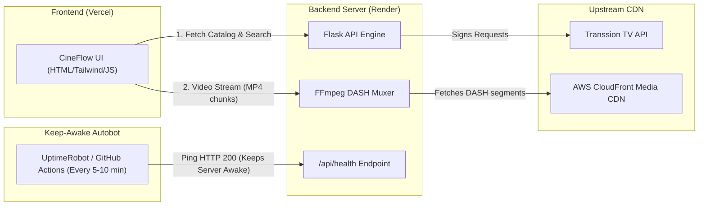

# Complete Deployment Plan: Vercel + Render + Keep-Awake Autobot

This guide provides the complete, step-by-step blueprint to deploy your streaming platform with a **free, blazing-fast setup that never sleeps**.

---

## 1. System Architecture



---

## 2. Why This Architecture?

| Component | Platform | Why It's the Best Choice | Cost |
| :--- | :--- | :--- | :--- |
| **Frontend** | **Vercel** | Global Edge CDN, lightning-fast static asset caching, free SSL, instant builds on `git push`. | **100% Free** |
| **Backend** | **Render (Docker)** | Supports **FFmpeg** out of the box via our Dockerfile, handles live stream remuxing and API signing. | **100% Free** (750 free hours/month) |
| **Autobot** | **UptimeRobot / GitHub** | Pings the server every 5-10 minutes to prevent the 15-minute inactivity spin-down. | **100% Free** |

### The Free Tier Math (Why Render is 100% Free 24/7)
- Render gives **750 free instance hours per month**.
- Total hours in a 31-day month = `31 days × 24 hours = 744 hours`.
- Since `744 < 750`, keeping **1 single backend server awake 24/7 uses 744 hours and costs $0.00**.

---

## 3. Step 1: Deploy Backend to Render

Because our backend requires `ffmpeg` to remux DASH streams into MP4 on the fly, we use the provided **[Dockerfile](file:///d:/New%20folder%20%284%29/Dockerfile)** (Render automatically builds it with Python 3.11 and FFmpeg).

### Step-by-Step:
1. Push your code to a GitHub repository (e.g. `github.com/your-username/cineflow`).
2. Go to **[dashboard.render.com](https://dashboard.render.com/)** and sign in.
3. Click **New +** $\rightarrow$ **Web Service**.
4. Select **Build and deploy from a Git repository** $\rightarrow$ connect your GitHub repo.
5. Configure the service:
   - **Name**: `cineflow-backend` (or your preferred name)
   - **Region**: Choose the closest region (e.g., `Singapore` or `Frankfurt` or `Oregon`)
   - **Language / Runtime**: Select **Docker** (Render will automatically detect the `Dockerfile`)
   - **Instance Type**: **Free** ($0/month, 512 MB RAM, 0.1 CPU)
6. Click **Create Web Service**.
7. Render will build the Docker container and output your live backend URL:
   ```text
   https://cineflow-backend.onrender.com
   ```
8. Verify it works in your browser:
   Visit: `https://cineflow-backend.onrender.com/api/health`
   You should see:
   ```json
   {
     "service": "CineFlow Streaming Engine",
     "status": "online",
     "timestamp": 1729700000,
     "uptime": "active"
   }
   ```

---

## 4. Step 2: Set Up the Keep-Awake Autobot

Render's free tier spins down (sleeps) if no traffic is received for **15 minutes**. When sleeping, the next request takes 30-50 seconds to cold start.

The Autobot prevents this by pinging `/api/health` every 5 to 10 minutes.

### Method A: UptimeRobot (Recommended — Takes 2 Minutes, Zero Maintenance)
1. Go to **[uptimerobot.com](https://uptimerobot.com/)** and create a free account.
2. In your dashboard, click **+ Add New Monitor**.
3. Configure the monitor:
   - **Monitor Type**: `HTTP(s)`
   - **Friendly Name**: `CineFlow Render Autobot`
   - **URL (or IP)**: `https://cineflow-backend.onrender.com/api/health`
   - **Monitoring Interval**: `Every 5 minutes`
4. Click **Create Monitor**.
5. **Done!** UptimeRobot will send an HTTP request every 5 minutes 24/7. Your Render server will **never sleep**.

### Method B: GitHub Actions Autobot (Alternative — Built into Repo)
We have already created the workflow file: **[.github/workflows/autobot_keep_awake.yml](file:///d:/New%20folder%20%284%29/.github/workflows/autobot_keep_awake.yml)**.
1. In your GitHub repository, go to **Settings** $\rightarrow$ **Secrets and variables** $\rightarrow$ **Actions**.
2. Click **New repository secret**.
   - **Name**: `RENDER_BACKEND_URL`
   - **Value**: `https://cineflow-backend.onrender.com`
3. Click **Add secret**.
4. Go to the **Actions** tab in GitHub $\rightarrow$ **Render Keep-Awake Autobot** $\rightarrow$ Click **Run workflow**.
5. It will now run automatically every 10 minutes.

---

## 5. Step 3: Deploy Frontend to Vercel

The frontend is modern HTML5, Tailwind CSS, and vanilla JavaScript located in `static/index.html`.

### Method A: Direct Vercel Deployment with Rewrites (Recommended)
We created **[vercel.json](file:///d:/New%20folder%20%284%29/vercel.json)**.
1. Go to **[vercel.com](https://vercel.com/)** and sign in with GitHub.
2. Click **Add New...** $\rightarrow$ **Project**.
3. Import your GitHub repository.
4. In the Project Configuration:
   - **Framework Preset**: `Other`
   - **Root Directory**: `./` (Root)
5. In **[vercel.json](file:///d:/New%20folder%20%284%29/vercel.json)**, add the rewrite pointing to your Render backend:
   ```json
   {
     "version": 2,
     "cleanUrls": true,
     "rewrites": [
       {
         "source": "/api/:path*",
         "destination": "https://cineflow-backend.onrender.com/api/:path*"
       },
       {
         "source": "/",
         "destination": "/static/index.html"
       },
       {
         "source": "/static/(.*)",
         "destination": "/static/$1"
       }
     ]
   }
   ```
6. Click **Deploy**.
7. Vercel will give you a live domain:
   ```text
   https://cineflow.vercel.app
   ```

### Method B: Client-Side Direct API Pointing
If you prefer the frontend to call Render directly (bypassing Vercel proxying for unlimited long video streams):
In `static/index.html`, set:
```javascript
const API_BASE = window.location.hostname === 'localhost' || window.location.hostname === '127.0.0.1'
  ? ''
  : 'https://cineflow-backend.onrender.com';
```
Because we already enabled full **CORS** (`Access-Control-Allow-Origin: *`) in [app.py](file:///d:/New%20folder%20%284%29/app.py), Vercel can talk directly to Render without CORS blocks!

---

## 6. Verification Checklist

- [ ] Visit `https://cineflow-backend.onrender.com/api/health` $\rightarrow$ returns HTTP 200 `{"status": "online"}`.
- [ ] Visit `https://cineflow.vercel.app` $\rightarrow$ loads homepage with banners, movies, and search.
- [ ] Search for a title (e.g. `Shinchan` or `Iron Man`) $\rightarrow$ results appear instantly.
- [ ] Play an episode/movie $\rightarrow$ video starts playing with synchronized audio.
- [ ] Check UptimeRobot $\rightarrow$ green status badge indicating continuous 24/7 uptime.
